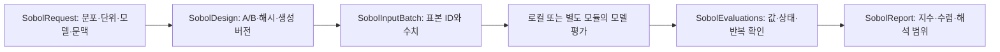

# 독립 입력의 전역 민감도 분석

`sensitivity.py`는 선언한 입력 분포 아래에서 결정론적 모델 출력의 분산을 분해한다. 부식속도·수소 농도·손상 여유·사용자 비용 등 수치 응답을 연결할 수 있다. 어느 입력의 불확실성이 결과 변동에 기여하는지 분석하며, 물리적 인과관계·설비 고장확률·재료 적합성은 각각 추가 근거가 필요하다.

추정기는 [SciPy Sobol API](https://docs.scipy.org/doc/scipy/reference/generated/scipy.stats.sobol_indices.html)를 호출한다. 입력 설계·단위/신원 계약·실패 처리·재현 기록·수치 품질 판정은 이 프로젝트에서 작성했다. 방법의 이론은 [Sobol의 분산 민감도](https://doi.org/10.1016/S0378-4754(00)00270-6), 수치 적분과 오차 해석은 [SciPy QMC 설명](https://docs.scipy.org/doc/scipy/reference/stats.qmc.html)을 참조한다. 외부 구현·문장·그림·실험 표를 복제하지 않는다.

## 적용 조건과 결과의 의미

입력들은 선언한 주변분포에 따라 서로 독립이고, 같은 입력에서 응답은 결정론적으로 재현돼야 한다. `independence_declared`, `deterministic_response_declared`가 참이 아니면 설계를 만들지 않는다. 재료 물성·시험 조건이 실제로 상관돼 있다면 독립 범위를 임의로 곱하지 않는다. 독립 잠재변수로 상관 입력을 생성하는 경우 지수는 그 잠재 좌표의 기여이며 원 물리 변수의 기여와 자동으로 같지 않다. 상관 입력의 Shapley 효과·조건부 민감도와 관측 잡음 분해는 후속 과제다.

독립 입력 `X`와 출력 `Y=f(X)`에 대해 다음 지수를 사용한다.

```text
S_i = Var[E(Y | X_i)] / Var[Y]
T_i = 1 - Var[E(Y | X_다른변수들)] / Var[Y]
```

`S_i`는 주 효과, `T_i`는 해당 입력이 참여하는 상호작용까지 포함한 총 효과다. 모집단 관계로는 주 효과 합이 1 이하이고 총 효과 합이 1 이상이다. 총 효과를 모두 더해 고장확률이나 위험률로 사용하지 않는다. 유한 표본 추정은 음수·1 초과·순서 역전을 보일 수 있으므로 값을 잘라내지 않고 수치 진단과 함께 보존한다.

출력 분산이 없거나 부동소수점 해상도에 비해 지나치게 작으면 지수는 정의되지 않은 상태로 남긴다. 상수 응답을 영향도 0의 확정 결과로 바꾸지 않는다. 여러 출력 중 다른 출력의 추정이 가능하면 그 결과는 보존하되 전체 보고서의 자료 부족 상태도 유지한다. 원 출력의 크기가 매우 크거나 작을 때는 분산 계산 전에 출력별로 척도화한다. 모델 내부에서 이미 잃은 정밀도까지 복구하는 것은 아니다.

## 연결하는 계약



| 계약 | 보존하는 내용 |
|---|---|
| `SobolRequest` | 자산·부위·시간 문맥, 평가자 ID/리비전/설정, 입력 분포·단위·근거, 응답 단위, 표본/비용/수치 기준 |
| `SobolDesign` | 생성 환경, native 단위의 A/B 행렬, 요청 스냅샷, 내용 digest |
| `SobolInputBatch` | 요청/설계 digest, 평가자 ID/리비전, scramble·블록·점 번호, 매개변수 값과 native 단위, 반복 확인 구분 |
| `SobolEvaluations` | 설계 digest와 연결된 응답 배치·각 행의 계산 상태·환경 선언·내용 digest |
| `SobolReport` | 요청/설계/평가 digest, 지수·반복 추정·표본 수 비교·품질·단위·근거·문맥 |
| `RegistrySensitivityConfiguration` | 등록 모델 ID, 고정 입력과 스칼라 입력의 단위 바인딩 |

배치와 점이 다른 순서로 도착해도 ID로 다시 맞춘다. 중복 점·알 수 없는 블록·다른 설계의 응답·해시 불일치는 거절한다. `computed`가 아닌 행, 누락, 비유한 출력이 있으면 이를 제거하거나 채워 넣어 다른 모집단의 민감도를 계산하지 않는다. 기본 로컬 실행은 첫 실패 배치에서 중지하며 보고서에는 관측한 실패와 아직 평가하지 않은 점 수를 구분한다.

각 scramble의 A 일부를 별도 호출로 다시 평가한다. 기본 재현 허용오차는 0이고, 응답별 절대/상대 허용오차를 명시할 수 있다. 불일치를 확인하면 기본 실행은 조기에 중지한다. 이 검사는 유한한 점만 확인하며 결정론적이라는 증명은 아니다. 허용오차를 넓혀 stochastic simulator나 QPU shot 잡음을 이 방법의 전제로 위장하지 않는다.

해시는 내용과 연결 관계를 확인한다. 외부 작업이 실제로 어떤 코드를 실행했는지나 분포 독립성·모델 타당성을 인증하지 않는다. 외부 평가를 `seal_sobol_evaluations`로 기록할 때 `runtime_metadata`를 명시한다. 생략하면 봉인 환경과 평가 환경 미선언을 기록한다. 로컬 편의 함수는 로컬 평가 환경을 기록한다.

## 입력 분포와 단위

`SensitivityMarginal`은 다음 네 종류를 지원하며 해당 종류의 필드만 허용한다.

| 종류 | 필드 | 의미 |
|---|---|---|
| `uniform` | `lower`, `upper` | 명시된 native 단위의 범위 |
| `normal` | `mean`, `standard_deviation` | 절단하지 않은 정규분포 |
| `lognormal` | `log_mean`, `log_standard_deviation`, `reference_value` | `X=reference_value*exp(log_mean+log_standard_deviation*Z)` |
| `quantile_table` | `probabilities`, `quantiles` | 0~1 끝점을 갖는 역 CDF 표의 선형 보간 |

분포에는 단위와 근거가 필수다. 로그 비율에는 offset이 없는 단위를 사용한다. 예를 들어 온도 비율은 검토한 kelvin 기준이 필요하다. 분위수 값은 감소할 수 없고 같은 값을 허용하지만, 선형 보간 표를 순수 범주·정수 분포로 자동 해석하지 않는다. 관측 최소/최대값을 모집단 상하한으로 자동 채택하지 않는다.

정규·로그정규 꼬리를 물리 범위에 맞추기 위해 몰래 자르지 않는다. 수치 표현 범위를 벗어나거나 물리 계산기가 범위 밖을 반환하면 중지하고 분포·모델 범위를 다시 검토한다. 사전에 검토한 bounded 분포는 분위수 표나 사용자가 작성한 평가 경로로 구성할 수 있다.

응답 지수의 단위는 항상 1이며 원 응답 단위를 별도로 기록한다. 단위 변환으로 게이지/절대압, H 원자/H₂ 분자, 유효/격자 확산계수와 같은 물리적 의미까지 결정하지 않는다. 이를 입력 근거와 모델 조건에서 먼저 대조한다.

## 수치 설계와 품질 기준

입력 수 `d`에 대해 2d 차원의 scrambled Sobol sequence를 생성해 A/B로 나누고, 각 A의 한 열을 B의 같은 열로 바꾼 블록을 만든다. [공식 생성기](https://docs.scipy.org/doc/scipy/reference/generated/scipy.stats.qmc.Sobol.html)의 `random_base2`를 사용하고, 첫 점 제거·간추림·임의 수의 표본 선택을 하지 않는다. 작은 표본 단계는 큰 설계의 prefix를 재사용한다. 기본값은 256·1,024·4,096점과 독립 scramble 8개다.

한 단계 최대 base 표본 수가 `N`, scramble 수가 `R`, 반복 확인 점이 `k`이면 전체 점 평가 예산은 `R*[N*(d+2)+min(k,N)]`다. 작은 prefix 단계마다 별도 모델 평가를 반복하지 않는다. 요청 예산과 저장 원소 상한을 생성 전에 검사한다. 계산 호출의 vectorization이나 외부 작업 비용은 별도다. SDK가 원격 서비스나 QPU를 자동 호출하지 않는다.

scramble별 지수를 구한 뒤 평균과 scramble 사이 표준오차를 계산한다. t 분포로 만든 근사 구간은 독립 scramble의 평균에 대한 수치 적분 진단이다. QMC의 상관된 개별 행을 iid라고 간주해 bootstrap하지 않는다. 분포 추정·재료 계수·모델 형태의 불확실성을 그 구간이 포괄한다고 표시하지 않는다.

보고서는 계산 상태와 수치 기준 충족을 분리한다.

- `status="computed"`: 최종 지수의 유한 추정이 가능하다.
- `precision_status="criteria_met"`: 마지막 두 표본 크기의 변화, scramble 구간 반폭, 이론적 관계의 허용오차가 사용자가 선언한 기준을 충족했다.
- `sampling_precision_unresolved`: 지수는 있지만 선언한 수치 기준이 충족되지 않았다.
- `needs_data` / `not_evaluable`: 미계산·비재현·분산 미확정 등으로 전체 해석이 불가능하다.

기준 충족은 모든 함수에서의 수렴 보증이나 명목 구간 포함률 보증이 아니다. 고차원·불연속·희귀 응답은 별도 해상도·대안 추정기를 검토해야 한다. 기준 미충족을 임의의 확정 순위나 수용 결정으로 바꾸지 않는다. 필요하면 sample power·scramble을 늘리거나 분포/모델을 재검토하고 원래 기록과 새 분석을 구분한다.

## Python API와 다른 모듈의 사용

```python
from matintegrity.sensitivity import (
    SobolRequest, create_sobol_design, evaluate_sobol_design,
    analyze_sobol_evaluations,
)

request = SobolRequest.model_validate_json(request_json)
design = create_sobol_design(request)
evaluations = evaluate_sobol_design(design, evaluator, batch_size=1024)
report = analyze_sobol_evaluations(design, evaluations)
```

요청 JSON은 실제 입력 분포·근거·문맥·평가자 버전을 포함한다. `evaluator`는 `dict[parameter_name, ndarray[point]]`를 받고 `[point, quantity]` 수치 배열을 반환한다. 응답이 하나면 1차원 배열도 가능하다. 전달 배열은 원 설계를 보호하는 읽기 전용 복사본이다. 물리 상태를 함께 반환할 때는 `SensitivityBatchResult(values, row_status)`를 사용한다. 행 상태는 `computed`, `needs_data`, `out_of_scope`, `invalid_input`, `invalid_output` 중 하나다. 비유한 computed 출력은 invalid output으로 기록하고 통과시키지 않는다.

다른 저장소에서 평가하려면 작업 시작 시 요청 또는 요청을 포함한 설계 설명을 전달하고, 이후 `iter_sobol_batches`의 JSON 입력 배치를 전달한다. 수신 측은 배치의 요청/설계 digest·평가자 ID/리비전·매개변수 단위를 작업 설명과 대조한 뒤 고정 설정으로 평가한다. 단위는 숫자의 native 단위이며 자동 SI 변환을 뜻하지 않는다. `SobolEvaluationBatch`는 같은 설계 digest·scramble·블록·점 ID로 반환하며 반복 확인 배치도 수행한다. `seal_sobol_evaluations`와 `analyze_sobol_evaluations`는 완료/부분 응답을 구분한다. 저장한 design·evaluations·report 세 파일을 함께 보존한다. 실제 사용자 자료가 담긴 숫자 기록은 로컬 `data/derived/` 등 제외 경로에 두고 배포 조건을 별도로 검토한다.

등록 계산기는 `registry_sensitivity_evaluator(registry, request)`로 연결한다. 설정에는 모델 ID·고정 입력·각 파라미터의 목표 입력 필드와 단위가 들어간다. 현재 편의 경로는 최상위 실수 스칼라 입력/출력을 지원한다. 중첩 자료·시간별 특정 지점·여러 모델 조합은 명시적인 사용자 callback에서 의미를 정해 반환한다. 모델 ID/리비전을 대조하고 scalar input/output의 affine 단위를 변환한다. 계산기의 범위 밖·자료 부족을 보존하며 입력/계약 ValueError는 invalid input으로 기록하고 중지한다. 오류 점을 재실행해 원인을 확인한다.

이 확장에는 별도의 `SobolReport` 스키마가 있다. 이를 `EventProbability`, 연간 빈도나 QSafety의 혼합 확률 배열에 넣지 않는다. 특정 기간의 PoF를 응답으로 선택해도 Sobol 지수는 그 응답의 분산 기여다. 실제 다른 저장소의 수신·실행은 `extension_requests/`에 따라 별도 검증한다.

## 재현과 검증

```powershell
.\.venv\Scripts\python.exe examples/sensitivity.py
.\.venv\Scripts\python.exe scripts/validate_sensitivity.py
.\.venv\Scripts\python.exe scripts/verify.py
```

쿠폰 예제는 mg·cm² 범위를 SI 입력에 연결하고 침식 깊이와 연환산 속도의 민감도를 계산한다. 범위는 작성한 합성 가정이며 실제 측정 불확실성으로 보정하지 않았다. 현재 예제는 8,224점 평가와 명시된 수치 기준을 충족했다. 이 숫자나 예제의 중요도 순위를 재료 일반 기준으로 채택하지 않는다.

독립 수학 비교에는 가산 함수의 알려진 분산, 순수 상호작용, 무관 입력, affine 단위/출력 척도, [Ishigami-Homma 함수](https://doi.org/10.1109/ISUMA.1990.151285)의 폐형식 모멘트를 사용한다. `validation/sensitivity_math.json`의 마지막 최대 절대 오차는 주 효과 약 0.00100, 총 효과 약 0.00128이다. 모듈 해시·평가자 소스 리비전·라이브러리 버전·설계/응답 digest를 기록하며 외부 실험 관측은 포함하지 않는다.

계약 검사는 재현성·분산 미확정·미달 정밀도·음수 추정 보존·누락/실패·재시도 중복·잘못된 설계 연결·순서가 바뀐 외부 응답·표현 범위·쿠폰 계산과 단위 변환을 확인한다. 같은 seed라도 라이브러리나 생성 알고리즘 버전이 바뀌면 숫자/해시가 바뀔 수 있으므로 환경과 보존한 실제 설계를 함께 사용한다.
